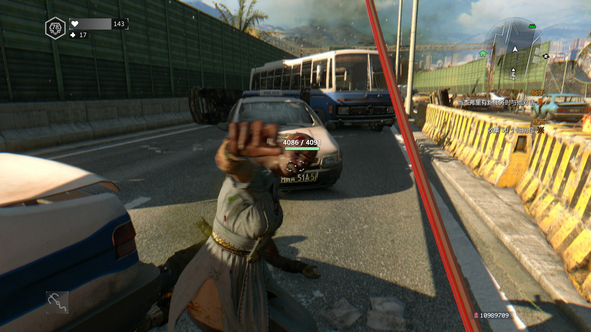
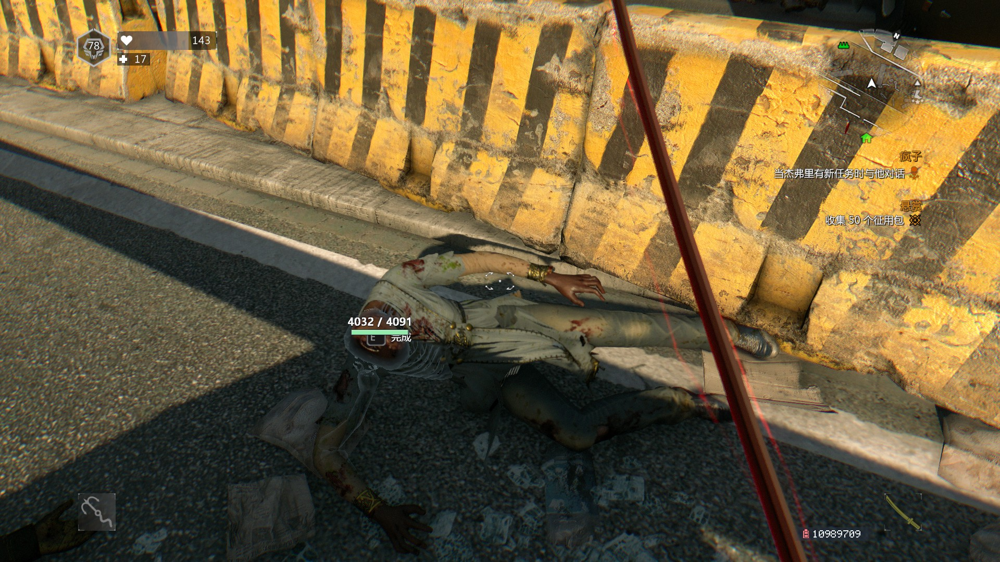

# Dying Light 1 — Enemy Health Bar Numbers & Floating Damage Numbers

<p align="center">
  <b>English</b> | <a href="README_CN.md">简体中文</a>
</p>

<p align="center">
  <a href="https://www.nexusmods.com/dyinglight/mods/1810">
    
  </a>
  <a href="LICENSE">
    
  </a>
  
</p>

A lightweight, native **DirectX 11 overlay mod** for **Dying Light (Steam 1.55, 64-bit)** that displays **exact enemy HP numbers** (`HP / MaxHP`) on sleek RPG health bars and **animated floating damage numbers** whenever you hit an enemy.

- **Built-in Bilingual Support (EN / 简体中文)**: Automatically detects your Windows UI language, or override via `language=auto|en|zh` in `dl1_hp_damage.ini`.
- **Zero Conflicts**: Loaded via a clean `winmm.dll` proxy — no `.pak` edits, fully compatible with **ReShade** (`dxgi.dll`), **crinloader** (`dsound.dll`), **DLMM**, and all weapon/gameplay mods.

## Preview

| Enemy Health Bar + Exact HP Numbers | Combat & Floating Damage Numbers |
| :---: | :---: |
|  |  |

## Features

- **Enemy Health Bars + Exact HP Numbers**: Displays current and maximum health (e.g. `1989 / 4091`, optional percentage) above enemies you aim at or recently damaged.
- **Zero Death-Lag / No Frozen Bars**: Unlike vanilla `HudEnemyHp` bars that freeze at partial or full HP when an enemy dies in 1–2 shots, this mod queries the engine's `IsDead()` state every frame and drops the bar to `0` immediately upon death.
- **Animated Floating Damage Numbers**: Pops crisp outlined damage numbers from enemies on melee, gunfire, arrows, explosions, and DoT ticks:
  - **White** — Normal hits
  - **Gold (enlarged)** — Heavy / critical hits (`>= 35%` of Max HP or `>= 400` damage, configurable)
  - **Red with `!` (enlarged)** — Killing blows
- **Delayed Damage-Drain Trail**: Smooth amber drain trail behind the green/yellow/red health bar fill, with distance scaling and fade-out.
- **Built-In Companion Mode**: Prefer keeping your vanilla / crinloader / 7px bar? Press **`F6`** (or set `draw_custom_bar=0`) to render **only** exact HP numbers + floating damage numbers.
- **Multi-Target Tracking**: Cleave attacks, grenades, and Molotovs display bars & damage numbers for all damaged enemies simultaneously.

## Installation & Uninstallation

### Install
1. Download the latest release archive from [Nexus Mods](https://www.nexusmods.com/dyinglight/mods/1810) (or build from source).
2. Extract **`winmm.dll`** and **`dl1_hp_damage.ini`** into your Dying Light root folder (next to `DyingLightGame.exe`).
3. Launch the game.

> **VAC / Multiplayer Notice**: This mod hooks game memory and DirectX 11 rendering. Use it in **single-player or private co-op with VAC disabled ONLY**. Do not use on VAC-secured public servers.

### Uninstall
Delete `winmm.dll`, `dl1_hp_damage.ini`, and `dl1_hp_damage.log` from your Dying Light root folder.

## In-Game Hotkeys

All hotkeys, bar dimensions, colors/thresholds, font scales, distances, and language settings can be customized in [`dist/dl1_hp_damage.ini`](dist/dl1_hp_damage.ini).

- **`F5`** — Toggle the entire overlay ON / OFF.
- **`F6`** — Cycle bar mode live in-game:
  1. **Custom Health Bar + HP Numbers** *(default, automatically hides vanilla bar to prevent overlap)*
  2. **HP Numbers Only** *(companion mode for vanilla / crinloader / 7px bars)*
  3. **Damage Numbers Only**

## Building from Source

Requires **Visual Studio 2022** (Desktop development with C++ x64 toolset & Windows SDK) and **PowerShell 7 (`pwsh`)**:

```powershell
# Build Release x64 DLL to dist/winmm.dll
pwsh -NoProfile -File build.ps1

# Build and install directly to your Dying Light folder
pwsh -NoProfile -File build.ps1 -Install

# Build and package a clean Nexus Mods release zip into release/
pwsh -NoProfile -File package_release.ps1 -Version "1.0.1"
```

## Architecture Overview

1. **Dynamic `winmm.dll` Proxy (`src/winmm_proxy.cpp`, `src/winmm_stubs.asm`)**: Resolves all 180 exports from `GetSystemDirectoryW()\winmm.dll` at runtime and forwards them with zero-overhead MASM64 jump stubs.
2. **Game Hooks & Projection (`src/game_hooks.cpp`)**:
   - Hooks `CHudEnemyHpItem::Update` (`gamedll_x64_rwdi.dll + 0x5d0740`, with exact prologue verification) and enables `HudEnemyHp` at `0x5d0d91` if vanilla (no crinloader).
   - Hooks `IControlObject::TakeDamage` (dynamically resolved via `GetProcAddress` on `engine_x64_rwdi.dll`), resolves `CAI*` via `*(*(controlObj + 0x8) + 0xa0)` validated by `HealthModule::owner == enemy`, and polls `(enemy + 0x350)->vtable[0x40]` (`IsDead()`) every frame under SEH guards.
   - Projects 3D world head coordinates via `IBaseCamera::GetCombinedMatrix`.
3. **Pure D3D11 2D Renderer (`src/d3d11_renderer.cpp`)**:
   - Does not require `D3D11_CREATE_DEVICE_BGRA_SUPPORT` (Dying Light creates its D3D11 device with `Flags = 0`).
   - Rasterizes `Segoe UI Bold` (ASCII) + `Microsoft YaHei UI Bold` (CJK toast glyphs) via GDI into a single `512x512` RGBA8 atlas and renders all bars & outlined text in a single batched draw call with full D3D11 pipeline state backup/restore.

## License

Released under the [MIT License](LICENSE).
