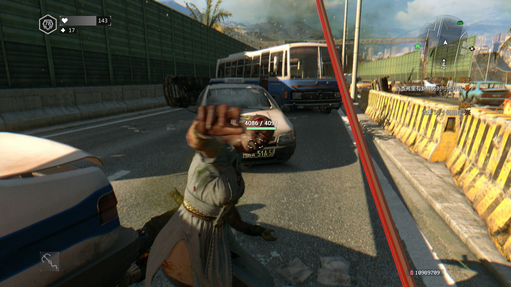
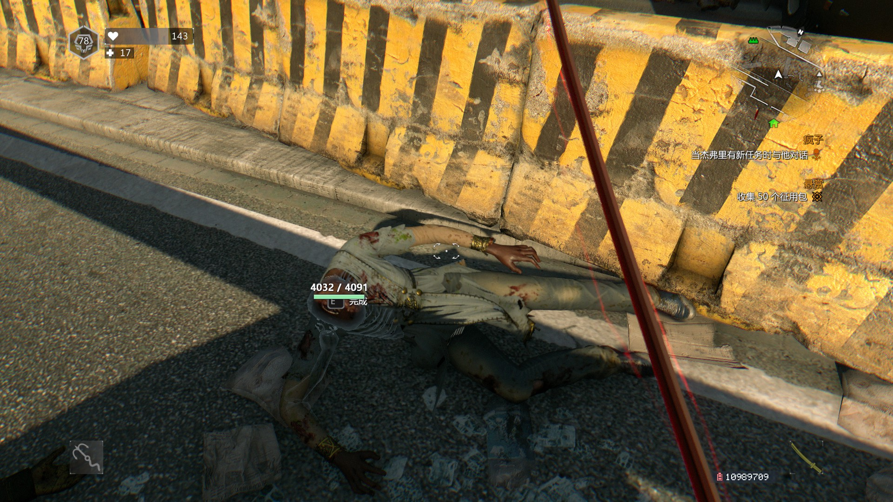

# 《消逝的光芒 1》敌人血条精确数值 & 攻击伤害飘字模组

<p align="center">
  <a href="README.md">English</a> | <b>简体中文</b>
</p>

<p align="center">
  <a href="https://www.nexusmods.com/dyinglight/mods/1810">
    
  </a>
  <a href="LICENSE">
    
  </a>
  
</p>

专为 **《消逝的光芒 1》（Steam 1.55 64位）** 开发的轻量级原生 **DirectX 11 覆盖层模组**：在敌人头顶显示**现代 RPG 血条 + 精确血量数字**（`当前HP / 最大HP`），并在每次攻击命中时实时弹出**伤害跳字**。

- **内置中英双语兼容**：默认 `language=auto` 自动跟随 Windows 系统语言（中文系统自动显示微软雅黑描边中文提示，英文系统显示英文），也可在 `dl1_hp_damage.ini` 中手动指定 `language=zh` 或 `en`。
- **零冲突独立运行**：通过 `winmm.dll` 代理加载，不修改任何 `.pak` / `.rpack` 文件，完美兼容 **ReShade**（`dxgi.dll`）、**crinloader**（`dsound.dll`）、**DLMM** 及所有武器/玩法模组。

## 实机预览

| 敌人血条 + 精确血量数字 | 战斗与伤害飘字 |
| :---: | :---: |
|  |  |

## 主要特性

- **敌人血条 + 精确血量数字**：在瞄准或近期受击的敌人头顶显示精确血量（如 `1989 / 4091`，可选附带百分比）。
- **彻底消除死后残血/满血定格**：原版 `HudEnemyHp` 在一两枪秒杀夜魔/丧尸时会跳过刷新导致血条定格在满血或残血；本模组每帧直读引擎 `IsDead()` 状态，敌人死亡瞬间血条立刻归零并平滑淡出。
- **攻击伤害飘字**：近战、枪械、弓箭、投掷物、爆炸与持续伤害均实时在 3D 受击位置弹出描边数字：
  - **白色** — 普通命中
  - **金色放大** — 重击 / 高伤（单次 ≥ 目标最大生命 35% 或 ≥ 400 伤害，可自定义）
  - **鲜红放大 + `!`** — 击杀一击
- **延迟扣血残影条 + 多目标追踪**：绿/黄/红分段血条搭配暖色扣血残影，范围斩击、手雷、燃烧瓶可同时追踪并显示多个受击敌人的血条与伤害数字。
- **内置伴侣模式**：如果你更喜欢保留原版 / crinloader / `HealthBars7px.pak` 血条，按 **`F6`**（或在 INI 中设 `draw_custom_bar=0`）即可切换为仅叠加血量数字与伤害飘字。

## 安装与卸载

### 安装
1. 前往 [Nexus Mods 发布页](https://www.nexusmods.com/dyinglight/mods/1810) 下载最新压缩包（或从源码自行构建）。
2. 将 **`winmm.dll`** 和 **`dl1_hp_damage.ini`** 复制到《消逝的光芒 1》游戏根目录（与 `DyingLightGame.exe` 同级）。
3. 直接启动游戏即可。

> **联机 / VAC 提醒**：本模组涉及内存读取与 DX11 渲染注入，请仅在**单人游玩或关闭 VAC 的私人联机**中使用，切勿在开启 VAC 的公共服务器使用。

### 卸载
删除游戏根目录下的 `winmm.dll`、`dl1_hp_damage.ini` 和 `dl1_hp_damage.log` 即可完全还原。

## 游戏内热键

所有热键、血条尺寸、字号、距离、保留时长、暴击阈值与语言均可在 [`dist/dl1_hp_damage.ini`](dist/dl1_hp_damage.ini) 中自定义。

- **`F5`** — 实时开关整个血条与伤害数字覆盖层。
- **`F6`** — 实时循环切换显示模式：
  1. **自定义血条 + 血量数字** *（默认，自动隐藏原版血条避免重叠）*
  2. **仅血量数字（原版血条）** *（伴侣模式，配合 crinloader / 7px 等原版血条使用）*
  3. **仅显示伤害跳字**

## 从源码构建

需要 **Visual Studio 2022**（含 C++ x64 工具链与 Windows SDK）与 **PowerShell 7 (`pwsh`)**：

```powershell
# 编译 Release x64 DLL 到 dist/winmm.dll
pwsh -NoProfile -File build.ps1

# 编译并直接安装到游戏目录
pwsh -NoProfile -File build.ps1 -Install

# 编译并生成 N 网发布压缩包到 release/
pwsh -NoProfile -File package_release.ps1 -Version "1.0.1"
```

## 技术原理

1. **`winmm.dll` 动态代理（`src/winmm_proxy.cpp`、`src/winmm_stubs.asm`）**：运行时通过 `GetSystemDirectoryW()` 加载系统真实 `winmm.dll`，使用 MASM64 零开销跳板完整转发全部 180 个导出。
2. **游戏数据 Hook 与投影（`src/game_hooks.cpp`）**：
   - Hook `CHudEnemyHpItem::Update`（`gamedll_x64_rwdi.dll + 0x5d0740`，含序言字节校验）；若未装 crinloader，则自动在 `0x5d0d91` 开启 `HudEnemyHp` 层。
   - 动态解析并 Hook `engine_x64_rwdi.dll` 导出的 `IControlObject::TakeDamage`，通过 `*(*(controlObj + 0x8) + 0xa0)` 与 `HealthModule::owner == enemy` 双重校验识别受击敌人，并在 SEH 保护下每帧轮询 `(enemy + 0x350)->vtable[0x40]`（`IsDead()`）与实时血量。
   - 通过 `IBaseCamera::GetCombinedMatrix` 将 3D 头部坐标投影为屏幕像素。
3. **纯 D3D11 2D 渲染器（`src/d3d11_renderer.cpp`）**：
   - 不依赖 `D3D11_CREATE_DEVICE_BGRA_SUPPORT`（DL1 默认 `Flags = 0`），通过 GDI 将 `Segoe UI Bold`（数字与英文）和 `Microsoft YaHei UI Bold`（中文提示字形）打包进单张 `512×512` RGBA8 图集，单次批处理渲染并完整备份还原 D3D11 管线状态，完美兼容 ReShade 6.x。

## 开源许可

本项目基于 [MIT License](LICENSE) 开源。
